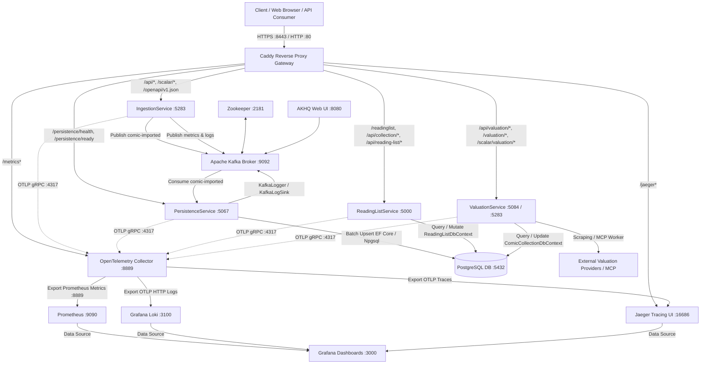

# ComicApp System Architecture

## 1. Executive Summary

ComicApp (Coinflip Parade) is an event-driven, microservices-based distributed platform designed for comic book ingestion, automated market valuation, catalog persistence, and reading list management. The platform maximizes operational efficiency, high-throughput batch processing, decoupled service boundaries, and comprehensive end-to-end observability.

The solution is containerized via Docker Compose and leverages modern .NET 9 microservices alongside battle-tested infrastructure components: **Apache Kafka** for asynchronous messaging, **PostgreSQL** for relational persistence, **Caddy** for unified reverse proxy routing and TLS termination, and a full **OpenTelemetry (OTel) + Prometheus + Grafana + Jaeger + Loki** observability stack.

---

## 2. High-Level Architecture Diagram



---

## 3. Core Application Services (.NET 9)

### 3.1 IngestionService
* **Primary Role**: High-throughput file and metadata ingestion engine for comic book catalogs (CSV uploads and REST payloads).
* **Framework**: ASP.NET Core (.NET 9).
* **Internal Ports**: `5283` (HTTP).
* **Key Components**:
  * `ComicCsvIngestor`: Parses input CSV records using `CsvHelper`, converts them into normalized domain events, and dispatches them asynchronously.
  * `KafkaProducer` / `IKafkaProducer`: Publishes ingestion events to Kafka topics (`comic-imported`, `comic-ingestion-metrics`, `comic-ingestion-logs`, `comic-ingestion-dead-letter`).
  * `DependenciesConfig`: Registers OpenTelemetry meters, counters, histograms, and Kafka producer singletons.
  * `Scalar / OpenAPI`: Interactive API documentation and exploration served under `/scalar/*` and `/openapi/v1.json`.

### 3.2 PersistenceService
* **Primary Role**: Event-driven worker and repository service responsible for materializing imported comic events into the relational database.
* **Framework**: ASP.NET Core (.NET 9).
* **Internal Ports**: `5067` / `7086`.
* **Key Components**:
  * `KafkaComicListener`: Long-running consumer background worker listening to `comic-imported` with configurable batching (`Kafka__BatchSize=10`) and offset commits.
  * `ComicCollectionDbContext`: Entity Framework Core context configured with PostgreSQL (`Npgsql.EntityFrameworkCore.PostgreSQL` and `EFCore.BulkExtensions.PostgreSql`) for high-performance batch upserts (`UpsertBatchAsync`).
  * `EventEntity` & `ProcessedEvent`: Tracks processed message IDs to guarantee idempotency and guard against duplicate processing.
  * `KafkaLoggerProvider` / `KafkaLogSink`: Streams service log entries back to Kafka topic `comic-ingestion-logs`.
  * Health endpoints: `/persistence/health`, `/persistence/ready`, `/persistence/live`.

### 3.3 ReadingListService
* **Primary Role**: User-facing web frontend and RESTful management API for browsing personal collections, search querying, and weekly reading list workflows.
* **Framework**: ASP.NET Core Razor Pages + Web API (.NET 9).
* **Internal Ports**: `5000` (HTTP).
* **Key Components**:
  * Razor UI Pages: `IndexModel`, `Weekly.cshtml`, `_ComicTable.cshtml`, and `_ComicTableRows.cshtml` for reactive server-side HTML rendering.
  * Controllers / APIs: `/api/collection/*` and `/api/reading-list/*`.
  * `ReadingListDbContext`: Direct relational data access layer targeting PostgreSQL `comicdb`.

### 3.4 ValuationService
* **Primary Role**: Automated market value research and background price assessment engine.
* **Framework**: ASP.NET Core (.NET 9).
* **Internal Ports**: `5283` (mapped to host `5084`).
* **Key Components**:
  * `ValuationBackgroundWorker`: Scheduled worker executing pricing runs across catalog items.
  * `McpClientWrapper` / `IMcpClientWrapper`: Model Context Protocol client for interacting with AI/LLM tools and external pricing intelligence.
  * Web Scraping Scripts: Automation engines (`research_comicbookrealm.js`, `research_ebay.js`) extracting live market transactions and valuation averages.
  * `ValuationController`: REST API for manual or triggered valuation updates (`/api/valuation/*`).
  * Interactive API Docs: Scalar UI routed via Caddy at `/scalar/valuation/*`.

### 3.5 SharedLibrary
* **Primary Role**: Shared domain models, contracts, and cross-cutting utility extensions referenced across all microservices.
* **Key Components**:
  * Contracts & Interfaces: `IKafkaProducer`, `KafkaOptions`, `KafkaConfiguration`.
  * Domain Models: `SharedLibrary.Models`, `ComicRecord`, shared DTOs.
  * Telemetry Utilities: `TelemetryExtensions`, standardized activity sources, metrics tagging.

---

## 4. Supporting Infrastructure & Containers

| Container Name | Base Image | Host / Internal Ports | Purpose |
| :--- | :--- | :--- | :--- |
| **`caddy`** | `caddy:2` | `80:80`, `8443:8443` | Reverse proxy gateway, SSL/TLS termination (`dev.crt`/`dev.key`), and unified path routing. |
| **`postgres`** | `postgres:15` | `5432:5432` | Relational storage for comic entities, reading lists, valuation history, and event idempotency tables. |
| **`kafka`** | `confluentinc/cp-kafka:7.5.0` | `9092` (internal) | Distributed streaming platform for asynchronous event ingestion, decoupling Ingestion and Persistence. |
| **`zookeeper`** | `confluentinc/cp-zookeeper:7.5.0` | `2181` (internal) | Distributed coordination and cluster metadata management for Kafka broker. |
| **`akhq`** | `tchiotludo/akhq:latest` | `8080:8080` | Web UI for Kafka topic management, message browsing, consumer group lag monitoring, and schema inspection. |
| **`otel-collector`** | `otel/opentelemetry-collector-contrib:latest` | `4317` (gRPC), `4318` (HTTP), `8888`, `8889`, `13133` | Central telemetry processing pipeline ingesting OTLP data and routing metrics to Prometheus, traces to Jaeger, logs to Loki. |
| **`prometheus`** | `prom/prometheus` | `9090:9090` | Time-series metrics engine scraping OTel collector data and evaluating alert rules (`prometheus-alerts.yml`). |
| **`grafana`** | `grafana/grafana` | `3000:3000` | Unified visualization platform with auto-provisioned dashboards and datasources (Prometheus, Loki, Jaeger). |
| **`jaeger`** | `jaegertracing/all-in-one:latest` | `16686:16686` | Distributed tracing backend and UI for end-to-end request latency profiling. |
| **`loki`** | `grafana/loki:latest` | `3100:3100` | Log aggregation engine indexing structured container and application logs. |

---

## 5. Event-Driven Messaging & Streaming Pipeline

The platform uses Apache Kafka as an asynchronous buffer to ensure resilient message flow and absorb traffic spikes during bulk ingestion.

### 5.1 Kafka Topics

* **`comic-imported`**: Carries newly parsed comic records from `IngestionService` to `PersistenceService`. Partitioned for horizontal scaling.
* **`comic-ingestion-dead-letter`**: Dead Letter Queue (DLQ) capturing unparseable, malformed, or unprocessable payloads for debugging without blocking consumer progress.
* **`comic-ingestion-metrics`**: Telemetry and ingestion performance events.
* **`comic-ingestion-logs`**: Streamed application logs generated via `KafkaLoggerProvider`.

### 5.2 Consumer Configuration
* **Consumer Group**: `comic-consumer-group`
* **Offset Strategy**: `Earliest` (ensures complete data replay on fresh starts or rebuilds).
* **Batch Processing**: Configured via `Kafka__BatchSize=10` to optimize PostgreSQL batch upsert efficiency.

---

## 6. Ingress Routing & Gateway Topology (Caddy)

Caddy serves as the unified HTTPS ingress entry point on port `8443` (and HTTP `80`), securing endpoints and routing requests to internal Docker network services:

```
HTTPS :8443
│
├── /readinglist*                 ──► ReadingListService:5000
├── /api/collection/*             ──► ReadingListService:5000
├── /api/reading-list/*           ──► ReadingListService:5000
│
├── /api/valuation/*              ──► ValuationService:5283
├── /valuation/*                  ──► ValuationService:5283
├── /scalar/valuation/*           ──► ValuationService:5283 (Rewritten to /scalar/*)
├── /openapi/valuation/v1.json    ──► ValuationService:5283 (/openapi/v1.json)
│
├── /api/*                        ──► IngestionService:5283
├── /ingestion/health|ready|live  ──► IngestionService:5283
├── /scalar/*                     ──► IngestionService:5283
├── /openapi/v1.json              ──► IngestionService:5283
│
├── /persistence/health|ready|live──► PersistenceService:5067
│
├── /jaeger*                      ──► Jaeger:16686
└── /metrics*                     ──► OtelCollector:8889 (Prometheus formatted metrics)
```

---

## 7. Observability & Telemetry Architecture

All .NET microservices export OpenTelemetry data over standard OTLP gRPC (`otel-collector:4317`). The collector processes and dispatches signals across dedicated backends:

```
[ .NET Microservices ]
  ├── IngestionService
  ├── PersistenceService  ──(OTLP gRPC :4317)──► [ OpenTelemetry Collector ]
  ├── ReadingListService                                │
  └── ValuationService                                 ├──► [ Prometheus :8889 / :9090 ] (Metrics)
                                                       ├──► [ Jaeger :4317 / :16686 ]   (Distributed Traces)
                                                       └──► [ Loki :3100 ]              (Structured Logs)
                                                                     │
                                                                     ▼
                                                             [ Grafana :3000 ]
```

### 7.1 Prometheus Alerting Rules (`prometheus-alerts.yml`)
* **Service Availability**: `IngestionServiceDown`, `PersistenceServiceDown`, `ValuationServiceDown` (triggers when scrape `up == 0` for 30s).
* **Pipeline Health**: `IngestionPipelineStalled` (alerts when request rate falls below 0.1 req/min for 5m).
* **Kafka Consumer Lag**:
  * `KafkaConsumerLagHigh`: Warning when consumer lag exceeds 1,000 for 2m.
  * `KafkaConsumerLagCritical`: Critical alert when consumer lag exceeds 5,000 for 1m.
* **Database Query Latency**:
  * `DatabaseLatencyHigh`: p95 query duration > 1.0s for 3m.
  * `DatabaseLatencyCritical`: p99 query duration > 2.0s for 2m.
* **Valuation Latency**: `ValuationLatencyHigh` (p95 latency > 10.0s for 5m).

---

## 8. Persistence & Data Storage (PostgreSQL)

* **Database Name**: `comicdb` (User: `comicadmin`, Default Port: `5432`)
* **Tables & Schemas**:
  * `Comics` / `ComicRecords`: Stores canonical comic details (Title, Issue Number, Publisher, Release Date, Grade, Valuation).
  * `ReadingLists`: Stores user reading list groupings, status (Read, To-Read, Wishlist), and ordering.
  * `ProcessedEvents` / `EventEntities`: Maintains transaction IDs and event timestamps to prevent duplicate event ingestion.
* **Optimization**:
  * Bulk operations executed using `EFCore.BulkExtensions.PostgreSql`.
  * Dedicated volume `postgres-data` for persistence across container lifecycles.

---

## 9. Key End-to-End Operational Workflows

### 9.1 Comic Ingestion & Persistence Flow
1. Client uploads a comic CSV file via `POST /api/comic-csv/upload` to Caddy, forwarded to `IngestionService`.
2. `IngestionService` validates and parses records with `ComicCsvIngestor`.
3. For each record, an event is emitted to Kafka topic `comic-imported` via `KafkaProducer`.
4. `PersistenceService` (`KafkaComicListener`) consumes batches of records.
5. Idempotency is verified against `ProcessedEvents`.
6. Batches are inserted/updated into PostgreSQL `comicdb` via `ComicCollectionDbContext.UpsertBatchAsync`.
7. Audit log is emitted to Kafka `comic-ingestion-logs` and telemetry is dispatched to `otel-collector`.

### 9.2 Valuation Assessment Flow
1. `ValuationBackgroundWorker` triggers on schedule or via `POST /api/valuation/run`.
2. Service scans database for comics lacking recent valuation or flagged for update.
3. Invokes web scraping routines (`research_ebay.js`, `research_comicbookrealm.js`) or MCP tool clients (`IMcpClientWrapper`).
4. Extracted market price points are normalized and persisted to `comicdb`.

### 9.3 User Browsing & Reading List Management Flow
1. User navigates to `https://localhost:8443/readinglist`.
2. Caddy routes request to `ReadingListService`.
3. Razor Pages query `ReadingListDbContext` for collection items and weekly pull lists.
4. Server renders dynamic HTML tables (`_ComicTable.cshtml`, `_ComicTableRows.cshtml`).

---

## 10. Architectural Benefits & System Characteristics

1. **Decoupled Asynchrony**: Ingestion throughput is decoupled from database write speeds by Kafka buffering, eliminating backpressure bottlenecks.
2. **Resilience & Fault Tolerance**: Failed ingestion records divert to DLQ without halting processing; database operations maintain idempotency.
3. **Unified Observability**: Distributed tracing correlates a single CSV upload across Caddy, Ingestion, Kafka, Persistence, and PostgreSQL within Jaeger and Grafana.
4. **Developer Experience & Maintainability**: Containerized setup via `docker-compose.local.yml`, interactive API documentation (Scalar UI), and management dashboards (AKHQ, Grafana, Jaeger).
